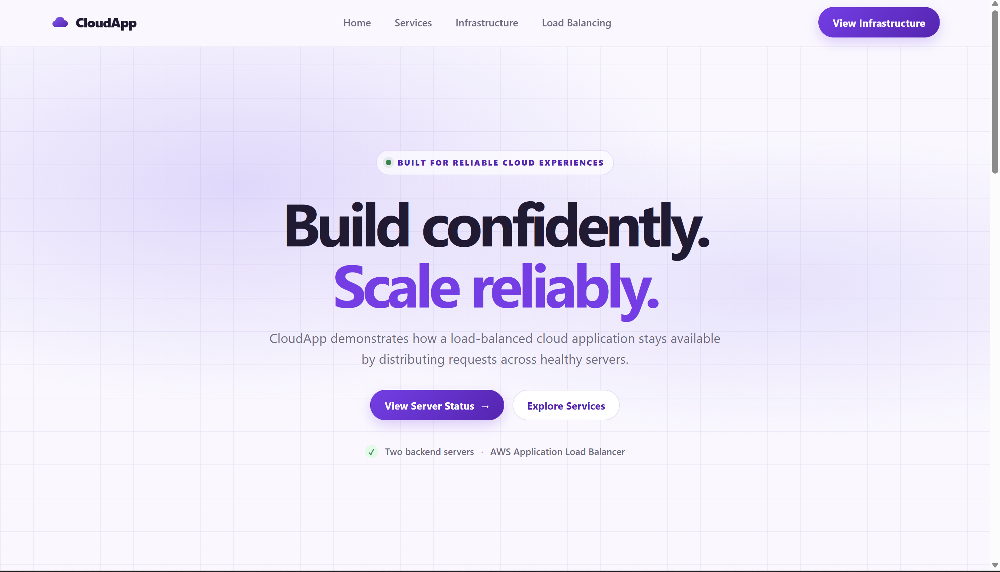
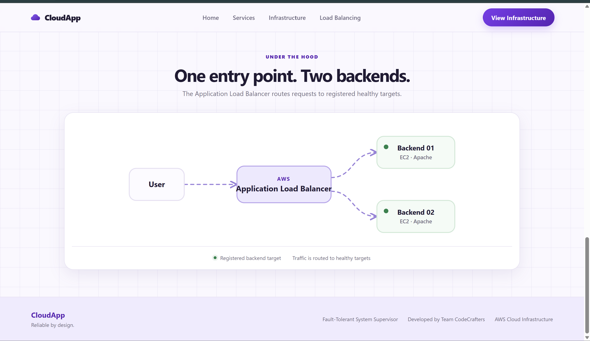
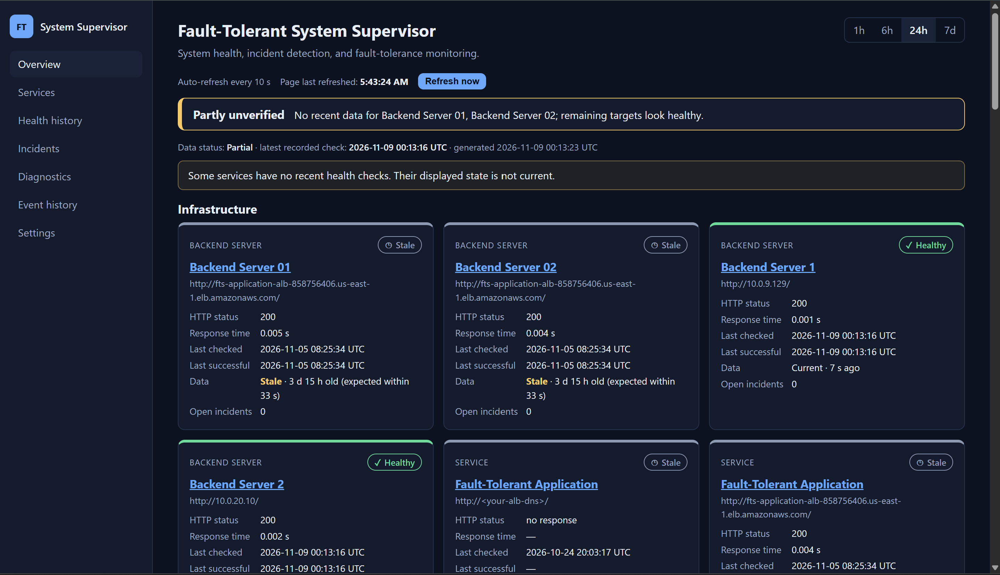
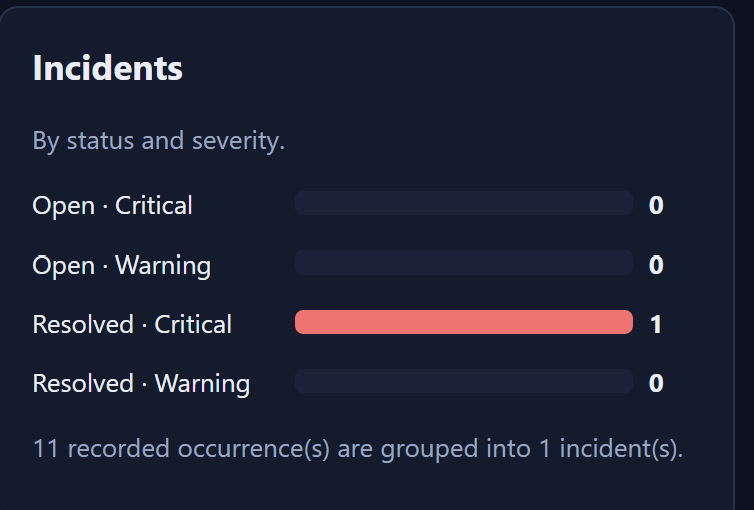

# Fault-Tolerant System Supervisor

An academic cloud computing project that demonstrates **backend health monitoring, load-balanced application delivery, failure diagnosis, and incident tracking** using Amazon Web Services (AWS).

The application is hosted on two backend Amazon EC2 instances behind an AWS Application Load Balancer (ALB). A separate Supervisor EC2 instance runs a Python monitoring process that checks each backend directly, classifies its health, records results and incident events in SQLite, and provides monitoring information through a Flask dashboard.

> **Implementation boundary:** The supervisor detects, diagnoses, and records failures. It does not automatically restart, replace, or repair EC2 instances or application services. The ALB independently performs target health checks and routes application traffic to healthy registered targets.

---

## Contents

- [Project overview](#project-overview)
- [Objectives and implemented features](#objectives-and-implemented-features)
- [Screenshots](#screenshots)
- [Technology stack](#technology-stack)
- [AWS infrastructure setup from scratch](#aws-infrastructure-setup-from-scratch)
- [Application and monitoring workflow](#application-and-monitoring-workflow)
- [Health classification and diagnosis](#health-classification-and-diagnosis)
- [Incident lifecycle](#incident-lifecycle)
- [Database design](#database-design)
- [Monitoring dashboard](#monitoring-dashboard)
- [Repository structure](#repository-structure)
- [Run the project on AWS](#run-the-project-on-aws)
- [Configuration](#configuration)
- [Failure and recovery demonstration](#failure-and-recovery-demonstration)
- [Testing and verification](#testing-and-verification)
- [Security and cost considerations](#security-and-cost-considerations)
- [Scope, limitations, and future enhancements](#scope-limitations-and-future-enhancements)
- [Academic project note](#academic-project-note)

---

## Project overview

A backend application can become unavailable because of a web-server failure, network issue, timeout, or other service problem. A single backend can become a single point of failure. A simple healthy/unhealthy indicator may also fail to explain what happened or preserve a useful record of the incident and its recovery.

The Fault-Tolerant System Supervisor demonstrates a small AWS-hosted environment in which:

1. Two backend EC2 instances host the sample CloudApp using Apache HTTP Server.
2. An Application Load Balancer distributes user requests across healthy registered backends.
3. A separate Python supervisor independently monitors each backend using HTTP requests.
4. Health results are classified and stored in a SQLite database.
5. A diagnosis component records likely causes based on observed HTTP and network results.
6. An incident manager creates, updates, escalates, and resolves incidents according to configured rules.
7. A Flask dashboard reads the stored data and presents infrastructure status, health history, response times, diagnostics, and incidents.

The ALB is responsible for application traffic distribution. The Python supervisor provides independent monitoring, diagnosis, and incident history.

## Objectives and implemented features

- Deploy two backend application servers on Amazon EC2.
- Distribute application traffic using an AWS Application Load Balancer.
- Independently monitor backend health using Python.
- Classify services as `HEALTHY`, `DEGRADED`, or `UNHEALTHY`.
- Diagnose common network and HTTP failures.
- Record timestamped health checks and incident history.
- Avoid duplicate incidents for repeated failures of the same service.
- Confirm recovery after consecutive successful checks.
- Provide a Flask dashboard for infrastructure monitoring.
- Demonstrate continued application availability when one backend becomes unavailable and another healthy target remains.

---

## Screenshots

The screenshots below are stored inside this repository. The relative paths are intentional: GitHub renders them when the `README.md` and `docs/` directory are committed together.

### CloudApp

The sample application is served by the backend EC2 instances and accessed through the ALB DNS endpoint.



The application demonstrates a single ALB entry point distributing requests to the registered backend targets.



### Monitoring dashboard

The Flask dashboard presents recorded infrastructure health, service status, health summaries, response-time information, and monitoring insights. It reads the SQLite database; it does not initiate health checks.



Incident information includes status, severity, and grouped occurrences.




### Component responsibilities

| Component | Responsibility |
|---|---|
| Application Load Balancer | Receives application requests, performs its own target health checks, and routes requests to healthy registered targets |
| Backend EC2 01 | Runs Apache and serves CloudApp |
| Backend EC2 02 | Runs Apache and serves CloudApp |
| Supervisor EC2 | Runs the Python monitoring process, diagnosis logic, incident manager, SQLite database, and Flask dashboard |
| Python monitoring engine | Sends independent HTTP checks to configured backend private IP endpoints |
| Diagnosis and incident manager | Interprets observed results and manages incident lifecycle records |
| SQLite | Stores service registrations, health checks, incidents, and incident events |
| Flask dashboard | Reads stored monitoring records and displays them |

### Important separation of responsibilities

- The **ALB** controls application traffic routing and performs its own target health checks.
- The **Python supervisor** independently checks backend endpoints and stores health and incident information.
- The **dashboard** reads stored records; refreshing the browser does not trigger a health check.
- The supervisor does **not** route application traffic or automatically repair infrastructure.

---

## Technology stack

| Layer | Technologies |
|---|---|
| Cloud platform | Amazon Web Services (AWS) |
| Compute | Amazon EC2 |
| Networking | VPC, public/private subnets, route tables, Internet Gateway, security groups |
| Traffic distribution | Application Load Balancer and target group |
| Web server | Apache HTTP Server |
| Sample application | HTML and CSS |
| Monitoring | Python and HTTP health checks |
| Dashboard | Flask, HTML, CSS, JavaScript, Jinja templates, SVG charts |
| Database | SQLite |
| Version control | Git and GitHub |
| Testing | Python `unittest` |

**Not part of the verified implementation:** Auto Scaling, Amazon CloudWatch, and Amazon RDS are not used by the current implementation described here. The monitoring and incident database is SQLite on the Supervisor EC2 instance.

---

## AWS infrastructure setup from scratch

This section explains how another developer can create an independent deployment in their own AWS account. It does not require access to the original AWS environment.

**All resource names, resource IDs, IP addresses, DNS names, key pairs, and credentials are deployment-specific.** Use values from your own AWS account. The CIDR blocks below are example values and can be changed if they conflict with an existing network.

### Prerequisites

- An AWS account with permission to create VPC, EC2, security groups, target groups, and load balancers.
- An AWS region selected for the deployment.
- An SSH key pair created in your own AWS account, if SSH access is used.
- Git and Python available on the Supervisor EC2 instance.
- Basic familiarity with EC2, VPC networking, and security groups.
- Awareness of any restrictions in AWS Academy Learner Lab or other educational AWS environments.

Check available services, instance types, permissions, and budget before provisioning resources.

### 1. Create a VPC

In the AWS Console, open **VPC → Your VPCs → Create VPC**.

Example:

| Setting | Example value |
|---|---|
| Name | `fault-tolerant-vpc` |
| IPv4 CIDR | `10.0.0.0/16` |
| Tenancy | Default |

Use a private IPv4 range that does not overlap with networks to which your VPC must connect.

### 2. Create subnets

For an ALB, create public subnets in at least two Availability Zones. Private subnets are recommended for backend and supervisor workloads where the chosen administration and egress design supports them.

Example address plan:

| Subnet | Example CIDR | Purpose |
|---|---|---|
| Public subnet A | `10.0.1.0/24` | Internet-facing ALB |
| Public subnet B | `10.0.2.0/24` | ALB in a second Availability Zone |
| Private subnet A | `10.0.11.0/24` | Backend and/or supervisor workload |
| Private subnet B | `10.0.12.0/24` | Additional private workload capacity |

Choose subnet placement based on your design. The supervisor must be able to reach both backend instances over the VPC network.

### 3. Configure the Internet Gateway and route tables

1. Create an Internet Gateway.
2. Attach it to the VPC.
3. Create or edit a public route table.
4. Add `0.0.0.0/0` with the Internet Gateway as the target.
5. Associate the public subnets with that route table.
6. Keep private subnet route tables separate. Do not add a direct Internet Gateway route to private subnets.
7. If private instances need outbound internet access for package installation or updates, configure a suitable egress method, such as a NAT gateway, or use a controlled administration/setup process.

NAT gateways can incur charges. Review pricing before creating one.

### 4. Create security groups

Use separate security groups where practical. This is a starting point; adapt the sources to your actual subnet and access design.

| Security group | Inbound port | Recommended source / purpose |
|---|---:|---|
| ALB security group | TCP 80 | Intended client range; public internet for a public demo |
| ALB security group | TCP 443 | Intended client range, if HTTPS is configured |
| Backend security group | TCP 80 | ALB security group; also allow supervisor security group for direct health checks |
| Supervisor security group | TCP 22 | Your trusted public IP only, if SSH is used |
| Supervisor security group | TCP 5000 | Your trusted IP only for temporary direct dashboard access, if enabled |

The supervisor must be able to send HTTP requests to backend port 80. Security groups are stateful, so response traffic is automatically allowed.

Avoid unrestricted SSH and unrestricted dashboard access. The Flask development server should not be exposed publicly. For remote dashboard access, prefer an SSH tunnel or another approved private access method.

### 5. Launch the EC2 instances

Launch three instances, subject to your AWS account's permissions, available instance types, and budget.

| Instance | Role | Suggested placement |
|---|---|---|
| Backend EC2 01 | Apache + CloudApp | Private subnet recommended |
| Backend EC2 02 | Apache + CloudApp | Private subnet recommended |
| Supervisor EC2 | Python monitoring + SQLite + Flask dashboard | Private subnet with secure administration, or a carefully restricted public subnet for a temporary lab |

For each instance:

1. Choose a supported Linux AMI. The project was tested on Amazon Linux.
2. Select an instance type permitted by your account.
3. Select the project VPC and intended subnet.
4. Attach the appropriate security group.
5. Select a key pair that you created in your own AWS account.
6. Choose suitable storage.
7. Launch the instance.
8. Record its **private IPv4 address** for internal communication.

Do not reuse another deployment's instance IDs, public IPs, private IPs, or key pairs.

### 6. Install Apache and deploy CloudApp on both backends

Connect to each backend through your chosen secure administration method. On Amazon Linux, install and start Apache:

```bash
sudo dnf update -y
sudo dnf install -y httpd
sudo systemctl enable --now httpd
```

Place the CloudApp static files in Apache's document root, commonly `/var/www/html/`. If the frontend files are included in the repository, transfer or copy those files to both backend instances. Otherwise, use the project's CloudApp files.

Example after transferring the site files:

```bash
sudo cp -r <cloudapp-files>/* /var/www/html/
sudo chown -R apache:apache /var/www/html/
sudo systemctl restart httpd
```

Verify on each backend:

```bash
curl -I http://localhost/
```

A successful response is normally `HTTP 200 OK`. Also verify that the Supervisor EC2 instance can reach each backend's private IP on TCP port 80.

### 7. Create the ALB and target group

1. Open **EC2 → Target Groups → Create target group**.
2. Choose **Instances** as the target type.
3. Select HTTP and port `80`.
4. Select the project VPC.
5. Set the health check path to `/`, unless a dedicated health endpoint has been implemented.
6. Register Backend EC2 01 and Backend EC2 02.
7. Create an **Application Load Balancer**.
8. For an internet-facing ALB, select at least two public subnets in different Availability Zones.
9. Attach the ALB security group.
10. Add an HTTP listener on port `80` and forward requests to the target group.
11. Wait for both registered targets to become healthy.

Use the ALB DNS name generated in your own AWS account:

```text
http://<YOUR_ALB_DNS_NAME>
```

### 8. Prepare the Supervisor EC2 instance

Connect to the Supervisor EC2 instance using your secure administration method.

Clone the repository:

```bash
git clone <YOUR_GITHUB_REPOSITORY_URL>
cd fault-tolerant-system-supervisor
```

Create and activate a virtual environment:

```bash
python3 -m venv .venv
source .venv/bin/activate
```

Install the dependencies. If the repository contains a general `requirements.txt`, use the dependencies documented there. The dashboard requirements file can be installed as follows:

```bash
python -m pip install --upgrade pip
python -m pip install -r requirements-dashboard.txt
```

Install any additional monitoring or test dependencies required by the actual repository. Do not install unrelated development dependencies on a production server unless they are needed.

### 9. Configure and start health monitoring

Find the **private IPv4 addresses** of your two backend EC2 instances in your own EC2 console. From the repository root on the Supervisor EC2 instance, activate the virtual environment and run:

```bash
python -m monitoring.supervisor \
  --target "Backend Server 01=http://<BACKEND_01_PRIVATE_IP>/" \
  --target "Backend Server 02=http://<BACKEND_02_PRIVATE_IP>/" \
  --timeout 3 \
  --interval 10 \
  --healthy-threshold 0.5 \
  --unhealthy-threshold 1.0
```

The supervisor checks each configured backend every 10 seconds and stores results in SQLite. Keep this process running while monitoring is required. Press `Ctrl+C` to stop it.

### 10. Start the Flask dashboard

Open a second terminal session on the same Supervisor EC2 instance. From the repository root:

```bash
source .venv/bin/activate

flask --app 'dashboard.app:create_app' run \
  --host 127.0.0.1 \
  --port 5000
```

Binding to `127.0.0.1` restricts the dashboard to the Supervisor instance itself. For access from your own computer, use an SSH tunnel or another approved private access method.

For a temporary lab demonstration only, direct access can be enabled by binding to `0.0.0.0` and restricting inbound TCP port `5000` in the Supervisor security group to your trusted public IP. Do not expose Flask's development server to the public internet.

The dashboard reads the SQLite database and refreshes its displayed data periodically. It does not initiate health checks.

### 11. Verify the deployment

- Open CloudApp through your ALB DNS name.
- Confirm the ALB target group reports both backend targets healthy.
- Confirm the supervisor records fresh checks for both backend private IPs.
- Confirm the dashboard displays current backend status and response times.
- Confirm new health-check records are written to SQLite.
- Perform the controlled failure demonstration described below, only on resources you own.

---

## Application and monitoring workflow

### Application traffic flow

1. A user opens CloudApp through the ALB DNS name.
2. The ALB forwards the request to a healthy registered backend.
3. Backend EC2 instances serve the CloudApp page using Apache.
4. Each backend has its own page identity to help identify which backend served a response.
5. The browser may request HTML and CSS assets separately. Since the ALB can route those requests independently, both backends contain the shared CSS asset.

### Independent health-monitoring flow

1. The supervisor loops through the configured backend targets.
2. It sends a direct HTTP request to each backend.
3. It records the HTTP result, response time, timestamp, health classification, and available diagnostic information.
4. The diagnosis and incident logic processes the result.
5. The supervisor writes health-check and incident records to SQLite.
6. The dashboard reads the stored information and presents it.

The dashboard does not perform health checks. If the supervisor is stopped, existing records remain in the database but become stale as they age.

---

## Health classification and diagnosis

The current project command uses these configured thresholds:

| State | Project rule |
|---|---|
| `HEALTHY` | HTTP 2xx and response time below `0.5` seconds |
| `DEGRADED` | HTTP 2xx and response time from `0.5` seconds to below `1.0` second |
| `UNHEALTHY` | No response, non-2xx response, or response time at least `1.0` second |
| `STALE` | Dashboard state indicating that the latest stored check is too old to represent current health |
| `NO_DATA` | Dashboard state indicating that no check has been recorded for the service |

These are project-configured thresholds, not universal industry standards. A request can return HTTP 2xx and still be classified as `UNHEALTHY` if its response time reaches the configured unhealthy threshold.

### Diagnosis mapping

| Observed result | Recorded diagnosis |
|---|---|
| Request timeout | Request timeout |
| Connection refused | Connection refused |
| DNS resolution failure | DNS resolution failure |
| Other network error | Connection failure |
| HTTP 4xx | HTTP client/request error |
| HTTP 5xx | HTTP server error |
| Slow HTTP 2xx response | Elevated or excessive latency |

These diagnoses are best-effort interpretations of observed network and HTTP results. They are not definitive proof of the underlying infrastructure fault.

`STALE` and `NO_DATA` are dashboard presentation states, not health states written by the supervisor. Stale data must not be presented as evidence of current availability.

---

## Incident lifecycle

The incident manager applies configured rules to health-check results:

- Two consecutive availability failures open a **CRITICAL** incident.
- Three consecutive degraded checks can open a **WARNING** incident.
- Repeated matching failures update the existing incident rather than creating duplicates.
- Persistent severe latency can escalate an incident from WARNING to CRITICAL.
- Two consecutive healthy checks confirm recovery and resolve an open incident.
- Creation, updates, escalation, and resolution are recorded in `incident_events`.

An incident groups related occurrences for a service. The occurrence count can therefore be greater than the number of incident records.

---

## Database design

The runtime database is:

```text
data/fault_tolerant_supervisor.db
```

It contains the following logical tables:

| Table | Purpose | Example fields |
|---|---|---|
| `services` | Registered monitored services | `service_id`, `service_name`, `service_url`, `timeout_seconds` |
| `health_checks` | Timestamped check results | `health_check_id`, `service_id`, `health_status`, `response_time_s` |
| `incidents` | Current and historical incident records | `incident_id`, `service_id`, `severity`, `status` |
| `incident_events` | Incident lifecycle history | `event_id`, `incident_id`, `event_type`, `description` |

The supervisor writes to the database. The dashboard opens it in read-only query mode.

The database and local backup files are runtime data and should not be committed to the source repository. A new deployment should initialize its own database using the project's database setup code.

---

## Monitoring dashboard

The Flask dashboard is located in `dashboard/`. It reads the shared SQLite database and does not start or control the supervisor.

| Dashboard area | Information displayed |
|---|---|
| Overview | Infrastructure status, service cards, health percentages, summary metrics, charts, insights, recent checks, and incidents |
| Services | Registered services, status, filtering, sorting, pagination, and service details |
| Health history | Recorded checks, health states, response times, and failure information |
| Incidents | Incident status, severity, category, occurrence count, and lifecycle details |
| Diagnostics | Observed failures and likely causes |
| Event history | Incident creation, updates, escalation, and resolution events |
| Settings | Database status, service information, role mapping, and registration configuration |

### Infrastructure health percentage

The overview calculates the health percentage for the two directly monitored backend services:

```text
Health percentage = (HEALTHY checks / All recorded checks) × 100
```

The overall percentage uses the combined check counts of Backend Server 01 and Backend Server 02 for the selected time range. It is a historical measurement for that range and should be considered alongside each service's current freshness state.

### Application status and freshness

- Fresh successful checks can be displayed as healthy.
- Old checks are labelled stale and are not treated as current health evidence.
- Services that have never been checked are shown as having no data.
- A healthy ALB response alone does not prove that every backend is healthy.
- The default stale window is based on the monitoring interval, request timeout, and configured stale multiplier.

The dashboard browser refresh interval defaults to 10 seconds. Refreshing the page reads stored data; it does not trigger a new health check.

---

## Repository structure

The repository is organized approximately as follows. The exact repository may contain additional files.

```text
fault-tolerant-system-supervisor/
│
├── monitoring/
│   ├── supervisor.py
│   ├── health_monitor.py
│   ├── incident_manager.py
│   └── database_manager.py
│
├── dashboard/
│   ├── app.py
│   ├── config.py
│   ├── routes.py
│   ├── services.py
│   ├── insights.py
│   ├── registration.py
│   ├── params.py
│   ├── templates/
│   └── static/
│
├── data/                       # Runtime database; do not commit
├── docs/
│   └── screenshots/
│       ├── cloudapp-home.png
│       ├── cloudapp-load-balancing.png
│       ├── dashboard-overview.png
│       └── dashboard-incidents.png
│
├── tests/
├── scripts/
├── requirements-dashboard.txt
└── README.md
```

---

## Run the project on AWS

This section is a concise operational reference after the AWS resources have been created. Use your own instance addresses and repository URL.

### Prerequisites

- Repository cloned on the Supervisor EC2 instance.
- Virtual environment and dependencies installed.
- Both backend EC2 instances running.
- Apache active on both backends.
- Network rules allowing the supervisor to reach backend HTTP port 80.

### Terminal 1 — Start the Flask dashboard

On the Supervisor EC2 instance:

```bash
cd ~/fault-tolerant-system-supervisor
source .venv/bin/activate

flask --app 'dashboard.app:create_app' run \
  --host 127.0.0.1 \
  --port 5000
```

Use an SSH tunnel or another secure access method to view a localhost-bound dashboard remotely. Do not expose the Flask development server publicly.

### Terminal 2 — Start health monitoring

Open a second terminal session on the same Supervisor EC2 instance:

```bash
cd ~/fault-tolerant-system-supervisor
source .venv/bin/activate

python -m monitoring.supervisor \
  --target "Backend Server 01=http://<BACKEND_01_PRIVATE_IP>/" \
  --target "Backend Server 02=http://<BACKEND_02_PRIVATE_IP>/" \
  --timeout 3 \
  --interval 10 \
  --healthy-threshold 0.5 \
  --unhealthy-threshold 1.0
```

Replace both placeholders with the current private IPv4 addresses of your backend instances.

### Stop the processes

When the demonstration or monitoring session is complete:

- Press `Ctrl+C` in the health-monitoring terminal.
- Press `Ctrl+C` in the dashboard terminal.

The EC2 instances and Apache services are independent of the browser-based Instance Connect sessions. Stop or terminate resources when they are no longer needed, while considering any data or resources that must be retained.

---

## Configuration

The supervisor accepts multiple targets using repeated `--target` arguments. The current deployment command monitors the two backend private IP endpoints directly.

Dashboard environment variables:

| Variable | Default / description |
|---|---|
| `SUPERVISOR_DB_PATH` | Project database path read by the dashboard |
| `DASHBOARD_REFRESH_SECONDS` | Browser refresh interval; default `10` seconds, configurable from 2 to 300 |
| `DASHBOARD_STALE_MULTIPLIER` | Multiplier used to determine stale data; default `3.0` |
| `DASHBOARD_SERVICE_ROLES` | Optional service role mapping |
| `DASHBOARD_ALLOW_REGISTRATION` | Optional service registration switch; enabled with `1` when configured |
| `DASHBOARD_ADMIN_TOKEN` | Required when optional service registration is enabled |
| `DASHBOARD_MAX_SERVICES` | Maximum registered service limit; default `50` |

Do not commit tokens, passwords, private keys, AWS credentials, or `.env` files to GitHub. If environment variables are needed, use a local `.env` file or an appropriate secret-management method and commit only a safe `.env.example`.

---

## Failure and recovery demonstration

The project supports a controlled backend web-server failure demonstration. Perform it only on project resources that you own and are authorized to modify.

1. Confirm both backend targets are healthy.
2. Connect to Backend EC2 01 and stop Apache:

   ```bash
   sudo systemctl stop httpd
   ```

3. Observe the supervisor report the backend as unhealthy and record the failure.
4. Observe the ALB target group mark Backend EC2 01 unhealthy after its own configured health checks.
5. Open CloudApp through the ALB. If Backend EC2 02 remains healthy, the application should continue responding through the remaining healthy target.
6. Restart Apache on Backend EC2 01:

   ```bash
   sudo systemctl start httpd
   ```

7. Verify Backend EC2 01 returns HTTP 200 again.
8. Observe consecutive healthy checks and the incident recovery event in the dashboard/database.

**Recovery is manual in this implementation.** The supervisor detects and records the failure; Apache is restarted manually. The supervisor does not automatically repair the instance or service.

---

## Testing and verification

### Automated tests

Run the test suite from the repository root:

```bash
python -m unittest discover -s tests -v
```

The recorded project test run completed with **145 tests passing in 5.554 seconds** (verification snapshot dated 9 November 2026).

Recorded module distribution:

| Test module | Tests |
|---|---:|
| `test_dashboard` | 25 |
| `test_dashboard_infrastructure` | 44 |
| `test_dashboard_pages` | 34 |
| `test_database_manager` | 20 |
| `test_health_diagnosis` | 5 |
| `test_incident_manager` | 7 |
| `test_multi_target_supervisor` | 5 |
| `test_supervisor` | 3 |
| `test_stage45_integration` | 2 |
| **Total** | **145** |

Dashboard tests account for 103 tests and monitoring/database/incident core tests account for 42 tests.

The automated scenarios cover healthy HTTP responses, HTTP 5xx diagnosis, request timeout, connection refusal, DNS failure, slow successful responses, persistence, repeated failures updating the same incident, consecutive healthy checks resolving incidents, multiple targets, one-backend failure isolation, stale data handling, and dashboard read-only behaviour.

Automated tests do not mean that 145 live AWS failure scenarios were executed. They are software tests; live AWS integration and controlled failure verification are separate activities.

### Recorded AWS integration verification

The project verification record includes:

| Verification | Recorded result |
|---|---|
| CloudApp on Backend EC2 01 | Loaded successfully |
| CloudApp on Backend EC2 02 | Loaded successfully |
| Application Load Balancer | Served CloudApp through a healthy backend |
| Backend health monitoring | Both backends returned HTTP 200 |
| Monitoring interval | 10 seconds |
| SQLite persistence | New health-check records appeared in the database |
| Dashboard endpoint | Returned HTTP 200 |
| Health percentage calculation | Reflected checks for the two monitored backends |
| Verified health percentage snapshot | 100% (204 healthy / 204 total checks) |
| Backend 01 failure simulation | Connection failure detected; ALB continued serving through Backend 02 |
| Backend recovery | Healthy checks recorded and earlier critical incident resolved |
| Incident event history | Creation, updates, and resolution retained |

The 100% health percentage is a snapshot of checks recorded during the selected time range at verification time. It is not a guarantee of future availability. Results may differ in a new deployment.

---

## Security and cost considerations

- The supervisor should reach backend instances through private VPC addresses.
- The ALB should be the public application entry point; backend instances should not require unrestricted public HTTP access.
- Restrict SSH access to trusted IP addresses.
- The current Flask dashboard has no login. Do not leave port `5000` open to the public internet.
- Use a secure private access method for the dashboard or deploy it behind an authenticated production-grade web server.
- Review and remove temporary security group access after demonstrations.
- Never publish AWS credentials, access keys, private SSH keys, tokens, or sensitive instance information.
- Review EC2, load balancer, public IPv4, NAT gateway, storage, and data-transfer charges before leaving resources running.
- Stop or delete unused billable resources when project work is paused or complete.

---

## Scope, limitations, and future enhancements

### Current implementation and limitations

- The supervisor monitors configured targets; automatic service discovery is not implemented.
- The supervisor does not automatically restart, replace, or repair EC2 instances or application services.
- ALB target health checks and traffic routing operate independently of Python monitoring.
- The dashboard displays stored data and does not itself perform health checks.
- SQLite is used for persistence on the Supervisor EC2 instance; Amazon RDS is not used in the verified deployment.
- The dashboard does not include authentication/authorization in the current implementation.
- Monitoring depends on configured target endpoints and network connectivity.
- Auto Scaling and CloudWatch are not part of the current verified implementation.

### Possible future enhancements

- Automated service discovery.
- Dashboard authentication and authorization.
- Critical incident notifications.
- Carefully controlled automated remediation.
- Support for additional backend instances and services.
- Advanced alert correlation.
- CloudWatch integration.
- A managed and more scalable database.

---

## Academic project note

This project demonstrates the integration of cloud networking, compute instances, load balancing, independent service monitoring, failure diagnosis, persistent incident tracking, and a web-based monitoring dashboard in an AWS environment.
